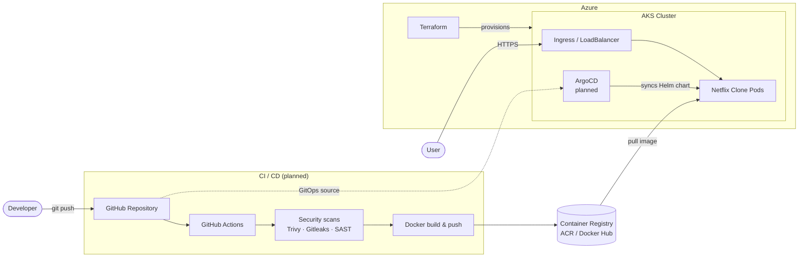

<div align="center">

# 🎬 DevSecOps Netflix Clone

**An end-to-end DevSecOps project: a Netflix-style frontend deployed to Azure Kubernetes Service (AKS) with Terraform, Docker and Helm — with CI/CD, security scanning and GitOps (ArgoCD) on the way.**


</div>

---

## 📖 Table of Contents

- [Overview](#-overview)
- [Architecture](#-architecture)
- [Tech Stack](#-tech-stack)
- [Repository Structure](#-repository-structure)
- [Prerequisites](#-prerequisites)
- [Getting Started](#-getting-started)
  - [1. Run locally](#1-run-locally)
  - [2. Run with Docker](#2-run-with-docker)
  - [3. Provision AKS with Terraform](#3-provision-aks-with-terraform)
  - [4. Deploy with Helm](#4-deploy-with-helm)
- [Environment Variables](#-environment-variables)
- [CI/CD Pipeline (planned)](#-cicd-pipeline-planned)
- [Security (DevSecOps)](#-security-devsecops)
- [GitOps with ArgoCD (planned)](#-gitops-with-argocd-planned)
- [Roadmap](#-roadmap)
- [Cost & Cleanup](#-cost--cleanup)
- [Troubleshooting](#-troubleshooting)
- [Contributing](#-contributing)
- [License](#-license)
- [Disclaimer & Credits](#-disclaimer--credits)

---

## 🔎 Overview

This project takes a Netflix-style frontend and wraps it in a **production-style cloud delivery workflow**:

1. The app is **containerized** with Docker.
2. The cloud platform (**Azure Kubernetes Service**) is created as code with **Terraform**.
3. The container is deployed to the cluster using a **Helm chart**.
4. *(In progress)* A **CI/CD pipeline** builds, scans and publishes the image.
5. *(In progress)* **ArgoCD** keeps the cluster in sync with Git (GitOps).

> 🚧 **Status:** under active development. Items marked *(planned)* are not finished yet — see the [Roadmap](#-roadmap) for the current state.

**What this project demonstrates**

- Infrastructure as Code on Azure
- Containerization best practices
- Kubernetes packaging and deployment with Helm
- Shifting security left (scanning in the pipeline)
- GitOps-based continuous delivery

---

## 🏗 Architecture



---

## 🧰 Tech Stack

| Layer | Technology |
|---|---|
| Frontend | Vite, TypeScript, Yarn |
| Containerization | Docker |
| Infrastructure as Code | Terraform |
| Cloud | Microsoft Azure (AKS) |
| Packaging / Deployment | Helm |
| CI/CD *(planned)* | GitHub Actions |
| Security scanning *(planned)* | Trivy, Gitleaks, Dependabot / CodeQL |
| GitOps *(planned)* | ArgoCD |

---

## 📂 Repository Structure

```text
devsecops-netflix-clone/
├── .vscode/            # Editor settings
├── infra/              # Terraform (AKS) and Helm chart
├── public/             # Static assets
├── src/                # Frontend source code
├── .dockerignore
├── .env.example        # Example environment variables
├── .gitignore
├── Dockerfile          # Container image definition
├── index.html
├── package.json
├── vite.config.ts
└── yarn.lock
```

> ✏️ **TODO:** expand the `infra/` section to match your real layout, e.g. `infra/terraform/` and `infra/helm/netflix-clone/`.

---

## ✅ Prerequisites

| Tool | Purpose | Check |
|---|---|---|
| [Node.js](https://nodejs.org/) (LTS) + [Yarn](https://yarnpkg.com/) | Run the app locally | `node -v && yarn -v` |
| [Docker](https://docs.docker.com/get-docker/) | Build and run the image | `docker -v` |
| [Terraform](https://developer.hashicorp.com/terraform/install) | Provision Azure resources | `terraform -v` |
| [Azure CLI](https://learn.microsoft.com/cli/azure/install-azure-cli) | Authenticate to Azure | `az version` |
| [kubectl](https://kubernetes.io/docs/tasks/tools/) | Talk to the cluster | `kubectl version --client` |
| [Helm](https://helm.sh/docs/intro/install/) | Deploy the chart | `helm version` |

You also need an **Azure subscription** with permission to create resource groups and AKS clusters.

---

## 🚀 Getting Started

```bash
git clone https://github.com/EmirDaku/devsecops-netflix-clone.git
cd devsecops-netflix-clone
```

### 1. Run locally

```bash
cp .env.example .env      # then fill in the values (see Environment Variables)
yarn install
yarn dev                  # starts the Vite dev server
```

Open the URL printed in the terminal (Vite's default is `http://localhost:5173`).

Production build:

```bash
yarn build
yarn preview
```

### 2. Run with Docker

```bash
docker build -t netflix-clone:local .
docker run --rm -p 8080:80 netflix-clone:local
```

Open <http://localhost:8080>.

> ✏️ **TODO:** adjust the container port (`80` above) to whatever your `Dockerfile` exposes.

### 3. Provision AKS with Terraform

```bash
az login
az account set --subscription "<SUBSCRIPTION_ID>"

cd infra            # or infra/terraform
terraform init
terraform fmt -check
terraform validate
terraform plan -out tfplan
terraform apply tfplan
```

Connect `kubectl` to the new cluster:

```bash
az aks get-credentials --resource-group <RESOURCE_GROUP> --name <AKS_CLUSTER_NAME>
kubectl get nodes
```

> ⚠️ **Never commit** `*.tfstate`, `*.tfvars` containing secrets, or credentials. For anything beyond a demo, use a **remote backend** (Azure Storage with state locking).

### 4. Deploy with Helm

```bash
# from the repo root (adjust the chart path to your layout)
helm upgrade --install netflix-clone ./infra/helm/netflix-clone \
  --namespace netflix --create-namespace \
  --set image.repository=<REGISTRY>/netflix-clone \
  --set image.tag=<TAG>

kubectl get pods -n netflix
kubectl get svc  -n netflix
```

Open the external IP of the service (or ingress) once it is assigned.

---

## 🔐 Environment Variables

Copy `.env.example` to `.env` and fill it in.

| Variable | Description | Required |
|---|---|---|
| `VITE_...` | *TODO: describe each variable from `.env.example`* | ✅ |

> ⚠️ **Important:** with Vite, every variable prefixed with `VITE_` is **embedded into the public frontend bundle**. Treat these values as **public**. Never put real secrets in them, never commit `.env`, and in CI store values as **GitHub Secrets**.

---

## ⚙️ CI/CD Pipeline (planned)

Target pipeline (GitHub Actions):

```text
push / PR
   │
   ├─ 1. Install & lint & build
   ├─ 2. Secret scan            (Gitleaks)
   ├─ 3. Dependency scan        (yarn audit / Dependabot)
   ├─ 4. IaC & chart scan       (Trivy config on Terraform + Helm)
   ├─ 5. Docker build
   ├─ 6. Image scan             (Trivy image — fail on HIGH/CRITICAL)
   ├─ 7. Push image             (ACR / Docker Hub, tagged with commit SHA)
   └─ 8. Update image tag in Helm values → ArgoCD syncs
```

Workflow files will live in `.github/workflows/`.

---

## 🛡 Security (DevSecOps)

Security is meant to be part of every stage, not an afterthought.

| Stage | Control | Tool | Status |
|---|---|---|---|
| Code | Secret detection | Gitleaks | ⬜ planned |
| Code | Static analysis | CodeQL / SonarQube | ⬜ planned |
| Dependencies | Vulnerability alerts | Dependabot / `yarn audit` | ⬜ planned |
| Container | Image vulnerability scan | Trivy | ⬜ planned |
| Container | Minimal image, non-root user, pinned base image | Dockerfile | ⬜ review |
| IaC | Misconfiguration scan | Trivy config / tfsec | ⬜ planned |
| Kubernetes | Resource limits, probes, `securityContext` | Helm values | ⬜ review |
| Secrets | No secrets in Git, use GitHub Secrets / Azure Key Vault | — | ⬜ planned |

Found a security issue? Please open a private security advisory on GitHub instead of a public issue.

---

## 🔄 GitOps with ArgoCD (planned)

Goal: Git is the single source of truth for what runs in the cluster.

```bash
# install ArgoCD (planned)
kubectl create namespace argocd
kubectl apply -n argocd -f https://raw.githubusercontent.com/argoproj/argo-cd/stable/manifests/install.yaml
```

An ArgoCD `Application` will point to this repo's Helm chart, with automated sync and self-heal enabled.

---

## 🗺 Roadmap

- [x] Frontend application (Vite + TypeScript)
- [x] Dockerfile
- [x] Terraform for AKS
- [x] Helm chart
- [ ] Architecture diagram and full documentation
- [ ] CI pipeline (build + lint)
- [ ] Security scanning in CI (Trivy, Gitleaks, dependency checks)
- [ ] Push images to a container registry
- [ ] Remote Terraform state (Azure Storage)
- [ ] Ingress + TLS (cert-manager)
- [ ] ArgoCD GitOps deployment
- [ ] Monitoring (Prometheus + Grafana)
- [ ] Multiple environments (dev / prod)

---

## 💸 Cost & Cleanup

AKS and its load balancer **cost money while running**. When you finish experimenting:

```bash
helm uninstall netflix-clone -n netflix
cd infra && terraform destroy
```

Then confirm in the Azure Portal that the resource group is gone.

---

## 🩺 Troubleshooting

| Problem | Try |
|---|---|
| `terraform apply` fails with quota / region errors | Pick another region or VM size, or check subscription quotas |
| `kubectl` cannot connect | Re-run `az aks get-credentials ... --overwrite-existing` |
| Pod in `ImagePullBackOff` | Check image name/tag and registry credentials (`kubectl describe pod`) |
| Service stuck on `<pending>` external IP | Wait a few minutes, then `kubectl describe svc` |
| Blank page after Docker build | Check the base path in `vite.config.ts` and the port mapping |

---

## 🤝 Contributing

Contributions, issues and suggestions are welcome.

1. Fork the repo
2. Create a branch: `git checkout -b feat/my-change`
3. Commit using [Conventional Commits](https://www.conventionalcommits.org/): `feat(infra): add remote state backend`
4. Push and open a Pull Request

---

## 📄 License

> ✏️ **TODO:** add a `LICENSE` file (MIT is a common choice for portfolio projects) and update this line.

Distributed under the MIT License. See `LICENSE` for details.

---

## ⚖️ Disclaimer & Credits

- This is an **educational project**. It is **not affiliated with, endorsed by, or connected to Netflix, Inc.** "Netflix" is a trademark of Netflix, Inc.
- Movie data/images (if used) come from [TMDB](https://www.themoviedb.org/). *This product uses the TMDB API but is not endorsed or certified by TMDB.*
- Built by [@EmirDaku](https://github.com/EmirDaku).

⭐ If you find this project useful, consider giving it a star!
